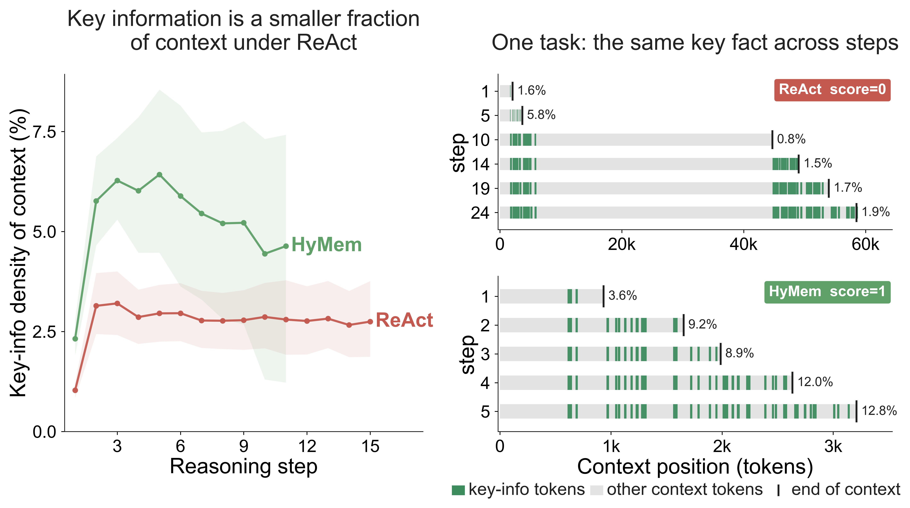
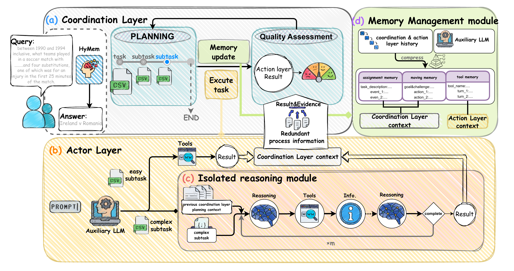
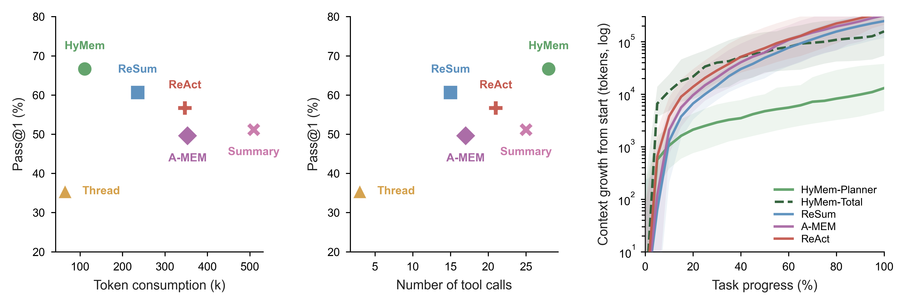
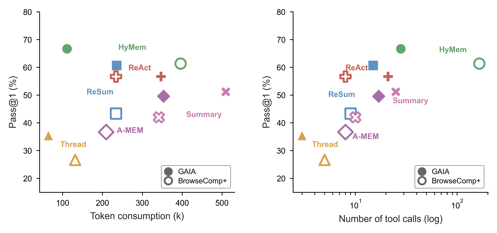

# HyMem: Hierarchical Context Management for Long-Horizon Agents via Information Isolation

[Paper (arXiv:2608.15703)](https://arxiv.org/abs/2608.15703) · [Interactive Project Page & Demo](https://dsqi-3721.github.io/HyMem/) · [Baseline Reproduction Notes](docs/baselines.md)

HyMem 是一个**无需微调模型权重**的长程 LLM Agent 上下文管理框架。针对多轮工具调用中原始日志不断膨胀、稀释核心任务目标的问题，HyMem 将高层规划与底层执行、子任务推理拆离到相互隔离的上下文空间中，仅通过结构化接口回传结论与证据，并按任务阶段分层注入记忆。

---

## 问题动机：长程任务中的上下文稀释

在 ReAct 等单上下文范式中，任务规划、工具原始输出和中间试错过程持续写入同一序列。随着交互轮次增加，少量高价值规划信号迅速被大量工具噪声淹没；事后摘要压缩或外部检索虽然能缩短长度，但依然作用于已经混合的序列，容易丢失关键推理链。



如图（来自 GAIA 真实轨迹统计）所示：同一复杂任务中，ReAct 上下文膨胀至近 60k tokens，关键事实密度降至 **1.9%** 并最终失败；HyMem 主规划上下文稳定在 **3.2k tokens** 内，关键信息密度保持在 **12.8%** 并正确完成任务。

---

## 框架设计

HyMem 从信息入口做**源头隔离**，由四个协作模块构成：



| 模块 | 职责 | 对应实现 |
|---|---|---|
| **Coordination Layer（规划协调层）** | 负责全局任务拆解、子目标调度与阶段评估，上下文中只保留高信噪比规划信号 | `agents/hymem_agent.py` |
| **Actor Layer（动作执行层）** | 在独立上下文中执行工具调用与环境交互，通过结构化 `RESULTS / RETURN` 接口只回传结论与证据 | `agents/bm_tools.py`、`agents/bm_sandbox.py` |
| **Isolated Reasoning（独立推理模块）** | 为复杂子任务分配隔离工作区进行多步分析与检索，避免中间探索污染主规划上下文 | `agents/complexity_router.py`、`agents/hymem_trigger.py` |
| **Memory Management（分层记忆模块）** | 将历史轨迹压缩为 **Episode / Working / Tool** 三类结构化记忆，按层级非对称注入新会话 | `agents/hymem_memory.py` |

---

## 实验结果

在同一评测管线与工具集下，将 HyMem 与 **ReAct**、**Summary**、**A-Mem**、**ReSum**、**Thread** 五类主流长程上下文/记忆管理方法在 **GAIA**（127 条文本任务）和 **BrowseComp-Plus**（150 条多跳推理检索任务）上进行对比（统计数据见 [`docs/stats/`](docs/stats/)，基线忠实复现说明见 [`docs/baselines.md`](docs/baselines.md)）：

### 主基准对比（Pass@1 与中位 Token 消耗）

| 框架 | GAIA Pass@1 ↑ | GAIA 中位 Token ↓ | BrowseComp-Plus Pass@1 ↑ |
|---|---:|---:|---:|
| **HyMem（Ours）** | **66.7%** | **111.2k** | **61.3%** |
| ReSum | 60.6% | 235.8k | 43.3% |
| ReAct | 56.7% | 347.0k | 56.7% |
| Summary | 51.2% | 509.2k | 42.0% |
| A-Mem | 49.6% | 353.1k | 36.7% |
| Thread | 35.4% | 64.5k | 26.7% |

* **准确率与成本帕累托优势**：在 GAIA 上，HyMem 比最强基线 ReSum 高 **+6.0 pp**，同时中位 Token 消耗由 235.8k 降至 **111.2k（降低 52.8%）**；较 ReAct 高 **+10.0 pp** 且中位 Token 降低 **67.9%**。
* **多跳检索泛化**：在 BrowseComp-Plus 上，HyMem 达到 **61.3%**，高于 ReAct（56.7%）、ReSum（43.3%）与 A-Mem（36.7%）；在复杂困难子集上较 ReAct 提升 **+16.0 pp**。
* **主规划上下文稳定受控**：任务结束时，HyMem 规划层中位上下文长度保持在 **14.6k tokens**，而 ReSum、A-Mem、ReAct 分别增长至 **249.0k / 320.1k / 362.9k tokens**。





---

## 仓库结构

```text
HyMem/
├── agents/                 # HyMem 核心框架及 ReAct / Summary / ReSum / A-Mem / Thread 基线实现
│   ├── hymem_agent.py      # 规划协调层与隔离执行主控
│   ├── hymem_memory.py     # Episode / Working / Tool 三级结构化记忆管理
│   ├── hymem_trigger.py    # 复杂度估计与上下文折叠触发器
│   ├── complexity_router.py# 子任务复杂度路由
│   ├── bm_tools.py         # 检索、网页浏览与文件工具集
│   └── bm_sandbox.py       # 隔离执行沙箱
├── envs/                   # 本地检索服务、在线检索封装与 vLLM 启动辅助
├── scripts/                # GAIA / BrowseComp-Plus 评测入口与统计绘图分析脚本
│   ├── eval_gaia.py        # GAIA 基准评测主脚本
│   ├── eval_bc.py          # BrowseComp-Plus 基准评测主脚本
│   └── analysis/           # 信息密度、帕累托前沿与上下文增长分析脚本
├── tests/                  # 单元测试（路由、沙箱、工具校验、各基线协议）
└── docs/                   # 在线交互展示页、论文图表与基线复现文档
```

---

## 快速开始

### 1. 环境准备

```bash
python -m venv .venv
source .venv/bin/activate
pip install -r requirements.txt
# 如需运行 A-Mem 或文件工具扩展，可按需安装：
# pip install -r requirements_amem.txt
# pip install -r requirements_file_tools.txt
```

### 2. 配置模型与检索接口

复制环境变量模板并填入你自己的 OpenAI 兼容模型地址与检索 API Key：

```bash
cp scripts/env_eval_local.sh.example scripts/env_eval_local.sh
cp scripts/serper_keys.json.example scripts/serper_keys.json
# 编辑上述文件填入模型服务地址与密钥后加载环境
source scripts/env_eval_local.sh
```

若使用本地部署的开源模型（如 Qwen3-32B），可参考 `scripts/serve_vllm_qwen32b.sh` 通过 vLLM 启动 OpenAI 兼容服务。

### 3. 运行单元测试与评测

```bash
# 运行核心模块单元测试
pytest tests/ -q

# 运行 GAIA 评测示例（支持 hymem / react / summary / resum / amem / thread）
python scripts/eval_gaia.py --help

# 运行 BrowseComp-Plus 评测示例
python scripts/eval_bc.py --help
```

---

## 引用

```bibtex
@article{wang2026hymem,
  title   = {HyMem: Hierarchical Context Management for Long-Horizon Agents via Information Isolation},
  author  = {Wang, Xinqi and others},
  journal = {arXiv preprint arXiv:2608.15703},
  year    = {2026}
}
```
